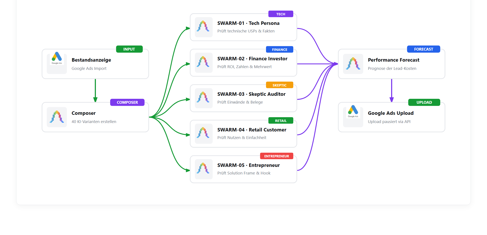

# Agent Swarms for Predictive Asset Testing

[](LICENSE)
[](https://github.com/SlavaWagner)
[](https://nodejs.org)

> **Predictive Creative Optimization Prior to Google Ads Launch**  
> Pre-produce up to 400 AI Ad Alternatives and test them against a 5-Agent Persona Swarm (Make.com Architecture: Walter, Christian, Jonas, Sarah, Alexander) before spending live ad budget on Google Ads.

> [!IMPORTANT]
> **Prerequisite for AI Processing:**  
> Please launch Google Antigravity beforehand using the command **`agy`** in your console. Interactive chat sessions, asset generation workflows, and AI agent processing run natively inside the Antigravity CLI.

---

## Overview & Purpose

In traditional SEA and Performance Marketing, finding winning ad creatives requires launching unverified variants live on Google Ads and spending thousands of Euros to gather statistical significance.

**Agent Swarms for Predictive Asset Testing** solves this bottleneck:
1. **Mass Pre-production**: Automatically pre-produces up to 400 cardinal AI ad alternatives (Responsive Search Ads & Performance Max Asset Groups) based on your campaign topic and baseline ad copy with strict Landing Page Grounding.
2. **AI Asset Decision Matrix Scoring**: Applies 6-dimensional asset vectorization (D1–D6) and scores every ad on 5 orthogonal score axes (Conversion, Audience Fit, Sentiment, Hook Interrupt, Tension Curve) to classify them into **Grades A, B, C, and D**.
3. **5-Agent Persona Swarm Testing**: Evaluates creative sets against a core swarm of 5 distinct test customer personas matching Make.com architecture (Walter, Christian, Jonas, Sarah, Alexander).
4. **Predictive Performance Projections**: Returns qualitative persona statements alongside predictive estimates for **CTR (%)**, **CPC (€)**, **CPM (€)**, and **Cost per Lead (CPL €)**.

> **No Google Ads API Authentication Required!**  
> You can input your campaign topic, target landing page URL, and baseline ad copy directly via CLI. No API credentials or OAuth setup needed.

---

## Architecture & System Circuit

<p align="center">
  
  <br>
  <em>System Circuit Architecture — <a href="docs/system-circuit.html">View interactive standalone widget</a></em>
</p>

```
 [Campaign Theme / Baseline Copy / Final URL]
                     │
                     ▼
 ┌───────────────────────────────────────────────┐
 │ 1. Mass Pre-production Engine                 │ ──► Generates up to 400 Cardinal AI Ad Alternatives
 │    (Strict Landing Page Grounding)            │     (Asset-Spine, Angles, & Story Themes)
 └───────────────────┬───────────────────────────┘
                     │
                     ▼
 ┌───────────────────────────────────────────────┐
 │ 2. AI Asset Decision Matrix                   │ ──► 6-D Vectorization & 5 Score Axes
 │    (Multi-Axis Scoring Engine)                │     Classifies Ads into Grades A, B, C, D
 └───────────────────┬───────────────────────────┘
                     │
                     ▼
 ┌───────────────────────────────────────────────┐
 │ 3. 5-Agent Persona Swarm Evaluation           │ ──► 5 Archetypes (Auditor, Investor, Tech, Family, Premium)
 │    (Make.com Aligned Scoring)                 │     Returns Direct Qualitative Quotes & Metric Projections
 └───────────────────┬───────────────────────────┘
                     │
                     ▼
 [Winning Ad Creatives + Projections (CTR, CPC, CPM, CPL) Ready for Launch!]
```

---

## The 5 Persona Swarm Agents (Make.com Architecture)

Rather than superficial feedback, the evaluation swarm utilizes 5 rigorously defined personas matching the Make.com agent configuration:

| Persona ID | Name & Profile | Focus & Evaluation Criteria | Mindset & Behavioral Trigger |
| :--- | :--- | :--- | :--- |
| **`SWARM-01`** | **Walter (54)**<br>*Skeptical Quality Auditor & Engineer* | Data Transparency, Exact Percentages, Proof Points & Anti-Hype | Allergic to typical AI buzzwords (*"simple"*, *"instant"*, *"the best"*). Demands verifiable facts, mathematical proof, and standards compliance. Tension drops on empty claims. |
| **`SWARM-02`** | **Christian (48)**<br>*Yield & ROI Investor* | Net Margin, Cashflow, Cost/Time Savings & Measurable ROI | No time for lifestyle fluff. Pure bottom-line focus: *"What is my actual economic leverage?"* Rejects vague marketing promises without financial substantiation. |
| **`SWARM-03`** | **Jonas (33)**<br>*Tech Founder & Automation Lead* | Asymmetrical Leverage, Modern Stack & Maximum Time Efficiency | Rejects sluggish, conservative agencies. Strongly triggered by metaphors like *"Asymmetrical Leverage"*, *"Autopilot"*, and *"Automated Pipeline"*. Demands innovative solutions. |
| **`SWARM-04`** | **Sarah (32)**<br>*Trust & Family Decision Maker* | Security, Guaranteed Pricing, Transparency & Reliability | Fears hidden fees, unfair clauses, and aggressive sales tactics. Responds positively to *"Security"*, *"Fixed Price"*, *"Tested"*, and clear upfront transparency. |
| **`SWARM-05`** | **Alexander (46)**<br>*Premium & High-End Buyer* | Exclusivity, First-Class Quality, Prestige & Discretion | Repelled by discount codes and cheap bargain-basement claims. Demands elite distinction, bespoke quality, and premium brand tone. |

---

## Mass Pre-production Engine (`PreproductionAgent`)

- **400 AI Ad Alternatives**: Generates 40 distinct groups × 10 variations = up to 400 alternatives in advance.
- **Strict Landing Page Grounding**: The engine enforces strict compliance with the target landing page (Final URL) — no invented features, no artificial guarantees, no buzzwords.
- **Strict Character Limit Enforcement**:
  - *Headlines*: Exactly max. 30 characters (including spaces).
  - *Long Headlines (PMax)*: Exactly max. 70 characters (or 90 for RSA).
  - *Descriptions*: Exactly max. 70 characters (or 90 for RSA).
  - *No Exclamation Marks*: Prohibits `!` across all generated assets.

---

## AI Asset Decision Matrix (`DecisionMatrix`)

Vectorizes every creative across **6 Input Dimensions**:
- **D1 – Framework**: `PAS` | `AIDA` | `FAB` | `MVP Pivot` | `Big Five` | `DISG`
- **D2 – Angle**: `ROI Proof` | `Risk Reduction` | `Speed` | `Authority` | `Scarcity` | `Status` | `Unconventional Metaphor`
- **D3 – Lifecycle Stage**: `Lead` | `Prospect` | `SAL` | `Opportunity` | `Customer`
- **D4 – Market Sophistication**: `1 (Broad)` | `2 (Aware)` | `3 (Narrow)`
- **D5 – Hook Type**: `Benefit` | `Proof` | `Urgency` | `Paradox` | `Curiosity` | `Uniqueness`
- **D6 – Sentiment**: `-1.0 ... 0 ... +1.0`

Assigns action-oriented grades:
- **Grade A (≥ 8.0)**: PMF Candidate – *Scale Up / Increase Budget*
- **Grade B (6.5 - 7.9)**: Test-Worthy – *Generate More Variants*
- **Grade C (5.0 - 6.4)**: Marginal – *Test Low Budget Only*
- **Grade D (< 5.0)**: Noise – *Kill / Archive*

---

## Installation & Getting Started

### 1. Install Globally via Antigravity CLI Ecosystem
```bash
npm install -g agent-swarms-predictive-asset-testing
```

### 2. Clone Repository & Run Locally
```bash
git clone https://github.com/SlavaWagner/agent-swarms-predictive-asset-testing.git
cd agent-swarms-predictive-asset-testing
npm install
```

### 3. Run Verification Test Suite
```bash
npm test
```

---

## CLI Usage & Commands

Run within the Google Antigravity CLI (`agy`) or terminal:

| Command | Description |
| :--- | :--- |
| `node bin/index.js preproduce`<br>*(Alias: `run`)* | Generates up to 400 AI ad alternatives, applies 6-D vectorization and Decision Matrix grading (A–D), evaluates against the 5-Agent Swarm, and calculates metric projections. |
| `node bin/index.js swarm-test` | Runs the 5-Agent Persona Swarm testing on existing or newly generated ad creatives, returning approval rates and CTR/CPC/CPM/CPL projections. |
| `node bin/index.js agent list` | Lists all registered persistent agents (`PreproductionAgent`, 5 Swarm Personas, `OrchestratorAgent`) with roles and system rules. |
| `node bin/index.js setup` | Interactive assistant to configure Gemini API Key and default campaign settings. |

### Example CLI Execution:
```bash
# 1. Generate 400 alternatives with 5-Agent Persona Swarm testing:
node bin/index.js preproduce -t "Real Estate Valuation" -k rsa -c 400 -u "https://www.slavawagner.de"

# 2. Test Performance Max Asset Groups:
node bin/index.js preproduce -t "High-Ticket B2B Lead Gen" -k pmax -c 40 -u "https://www.slavawagner.de"

# 3. Run standalone 5-Agent Swarm simulation:
node bin/index.js swarm-test -k rsa
```

---

## Make.com AI Agents Integration (Blueprints)

Ready-to-use, anonymized **Make.com Blueprints** are provided in [`make-blueprints/`](make-blueprints/):

*   **`SWA Agent Swarms for Predictive Asset Testing (Asset Creation).blueprint.json`**: Full Make.com blueprint orchestrating angle discovery, Gemini multimodal asset generation, and 5-Agent Swarm evaluation.
*   **`SWA Agent Swarms for Predictive Asset Testing (5-Agent Swarm).blueprint.json`**: Anonymized template pre-configured for instant import with zero customer data or tokens.

For complete import and configuration steps, see the [Make Blueprints Guide](make-blueprints/README.md).

---

## License

Distributed under the MIT License. See [`LICENSE`](LICENSE) for details.

---

*Created with Google Antigravity CLI | 100% Compliant SEA Architectures*
